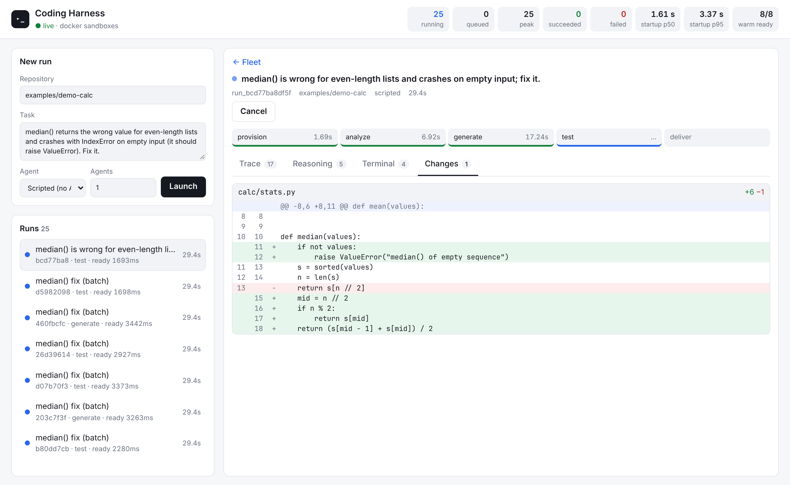
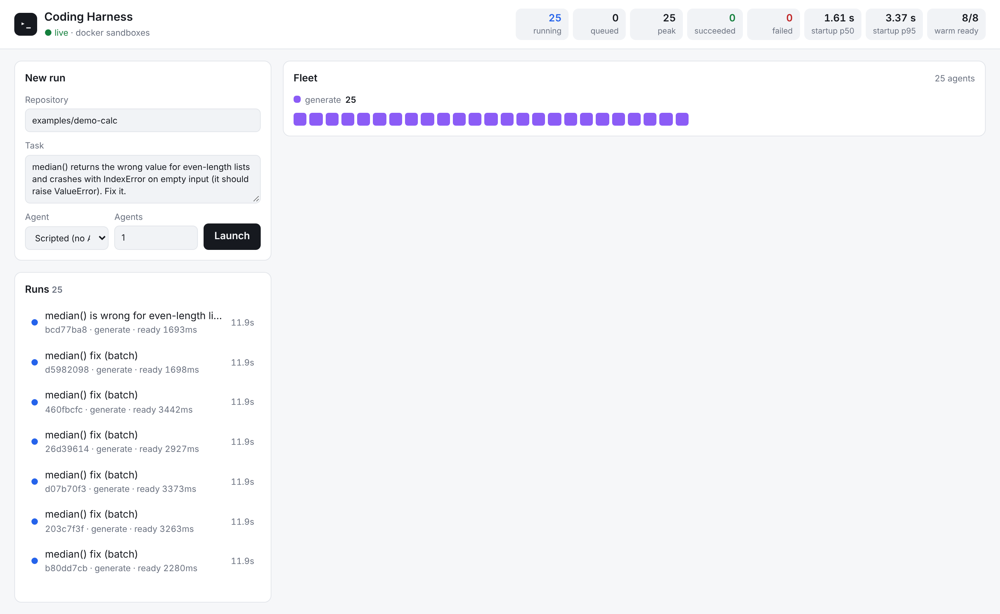
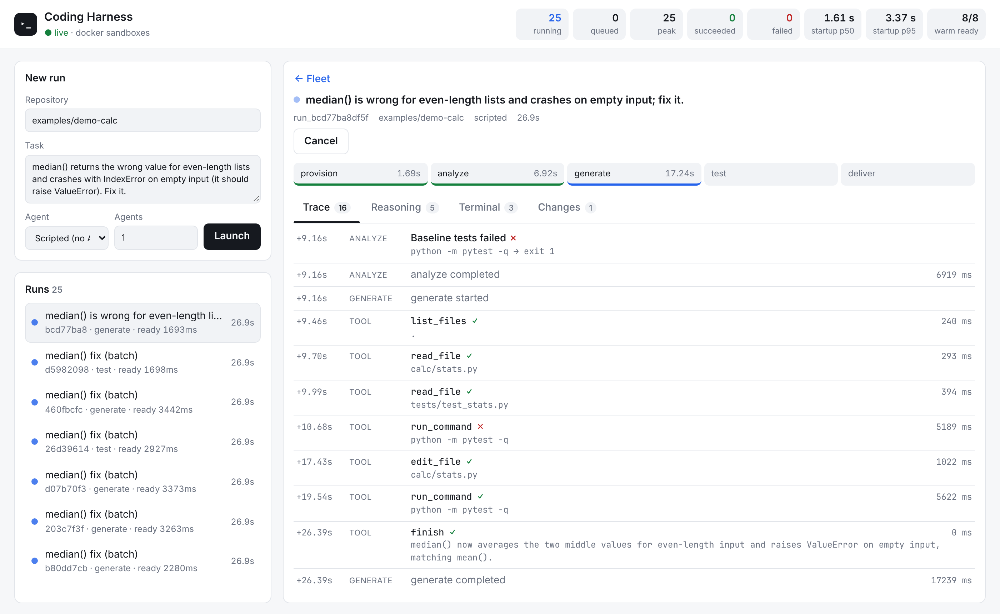
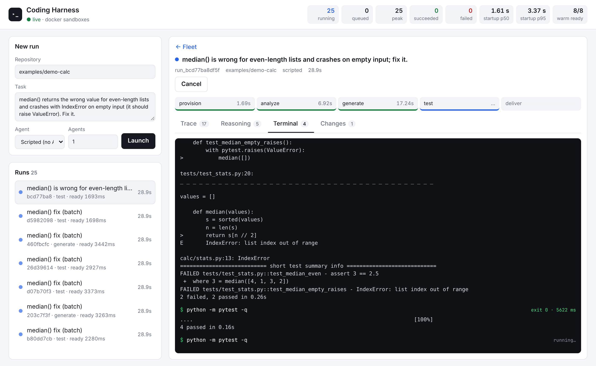

# Cloud Coding Harness

An open-source harness for running many autonomous coding agents in parallel, each in its own
isolated sandbox, with a React control plane that streams what every agent is doing live.

Give it a repository and a task. For each agent it starts a hardened container from a prebuilt
image, checks the repository out from a local mirror cache, and drives an
**analyze → generate → test → repair → deliver** loop until the tests pass. The result is a
`git am`-ready patch. Claude is the default model; a scripted agent is included so everything
can be run and benchmarked without an API key.



## What it does

- **Runs 100+ agents at once.** An asyncio scheduler runs each agent as a coroutine, not a
  thread. Sandboxes are Docker containers driven through the Docker Engine API over its unix
  socket, so no CLI process is spawned per command. The test suite runs 120 concurrent agents,
  and [the benchmark](docs/BENCHMARKS.md) runs 120 in Docker on a 4-vCPU host with all 120
  succeeding.
- **Isolates each agent.** Every sandbox has no network, drops all Linux capabilities, sets
  `no-new-privileges`, has a read-only root filesystem, runs as a non-root user and has CPU,
  memory and PID limits. All file I/O goes through the sandbox, so an agent can't use a
  symlink to reach the host. Tests check these properties.
- **Runs the whole loop on its own.** It does static repo analysis, a baseline test run, a
  tool-using model loop (read, edit, search, run commands), the test suite, and repair rounds
  that feed failures back to the model. It ends with patch delivery.
- **Starts sandboxes fast.** Prebuilt images, a warm pool of already-running containers and a
  bare-mirror repository cache (`git clone --shared`) take time-to-ready on
  [pallets/flask](https://github.com/pallets/flask) from **2.75 s cold to 151 ms warm** (p50,
  measured, [reproducible](docs/BENCHMARKS.md)).
- **Streams everything live.** A Server-Sent Events API carries execution traces, the model's
  reasoning (summarized thinking, streamed as it's generated), terminal output per command,
  and the diff as it changes. A React control plane renders it all. Reconnects resume
  losslessly from the last event.

| Fleet view | Trace | Terminal |
|---|---|---|
|  |  |  |

## Quick start

**With Docker Compose** (orchestrator, control plane and sandbox image):

```bash
cp .env.example .env          # optionally add ANTHROPIC_API_KEY
docker compose up --build
open http://localhost:8080    # launch the demo task, or set Agents to 100
```

**From source** (Python 3.11+, Node 20+, Docker):

```bash
make setup                    # venv + npm install
make image                    # build the sandbox image (cch-sandbox:latest)
make demo                     # one scripted agent fixes examples/demo-calc in a sandbox, streamed to your terminal
make api                      # API on :8080, serves the built UI if web/dist exists
make web                      # or: Vite dev server on :5173 with hot reload
```

No Docker? `make api-local` uses a plain-subprocess driver for development. It keeps
workspaces separate but is **not** an isolation boundary.

To use Claude, set `ANTHROPIC_API_KEY` and pick "Claude" in the UI, or pass `--provider anthropic`
to `harness run`. The default model is `claude-opus-5-5` with adaptive thinking and summarized
reasoning display. Change it with `HARNESS_ANTHROPIC_MODEL` and `HARNESS_ANTHROPIC_EFFORT`.

## API

| Method | Path | |
|---|---|---|
| `POST` | `/api/runs` | Start one agent: `{repo, ref?, task, test_command?, agent: {provider, model?, effort?, max_turns?, script?}}` |
| `POST` | `/api/runs/batch` | Same body plus `count`: fan out N agents |
| `GET` | `/api/runs`, `/api/runs/{id}` | Run state |
| `GET` | `/api/runs/{id}/events` | SSE stream of the run's events (supports `Last-Event-ID`) |
| `GET` | `/api/runs/{id}/patch` | The delivered patch (`git am` format) |
| `POST` | `/api/runs/{id}/cancel` | Cancel a queued or running agent |
| `GET` | `/api/stream` | SSE feed of run status changes and metrics |
| `GET` | `/api/metrics` | Counts, concurrency, startup and duration percentiles, pool and cache stats |

`repo` can be a git URL, a local git repository, or a plain directory (snapshotted into the cache).

## Repository layout

```
orchestrator/harness/
  orchestrator.py     scheduler, run lifecycle, metrics
  agent/loop.py       analyze → generate → test → repair → deliver
  agent/tools.py      tools the model can call (all execute inside the sandbox)
  sandbox/docker.py   hardened containers via the Docker Engine API
  sandbox/pool.py     warm pool
  repocache.py        bare-mirror cache + `git clone --shared` checkouts
  llm/                Claude (streaming, adaptive thinking) and the scripted provider
  api.py              FastAPI + SSE
web/src/              React control plane (fleet, trace, reasoning, terminal, diff)
sandbox-image/        the prebuilt sandbox image
scripts/bench.py      reproducible benchmarks
examples/demo-calc/   buggy demo repo + scripted agent trace
integrations/roblox/  optional 3D fleet viewer for Roblox Studio
```

## Docs

- [Architecture](docs/ARCHITECTURE.md): components, data flow, the security model, and design trade-offs
- [Benchmarks](docs/BENCHMARKS.md): methodology, results, and how to reproduce them
- [Learning guide](LEARNING.md): a beginner-friendly walkthrough of every concept and file
- [Roblox viewer](integrations/roblox/README.md): watch the fleet as a 3D scene

## Limitations

- Single orchestrator process with in-memory run state. Event logs and patches persist to disk,
  but queued runs don't survive a restart. Scaling out means sharding runs across orchestrators
  or Docker hosts. Sandbox capacity per host is CPU-bound (see benchmarks).
- Sandboxes have no network, so dependencies must be in the image. Extend `sandbox-image/`
  for your stack.
- Delivery is a patch file. Opening pull requests automatically is not implemented.

## License

[MIT](LICENSE)
